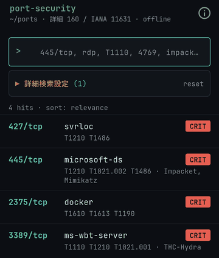
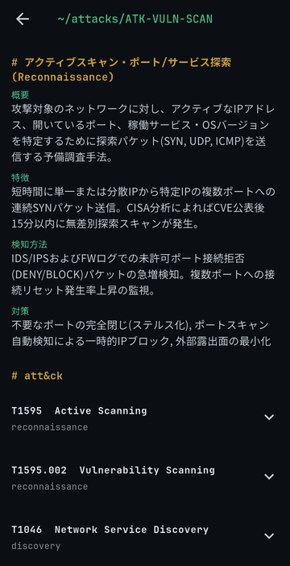
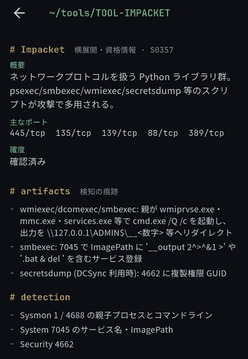
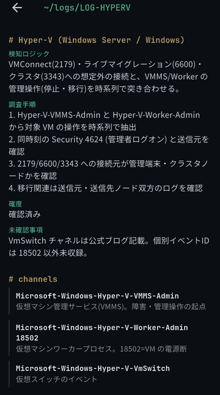

# Port Security

**オフラインで引ける、ポート／プロトコル調査ツール（Android）**

ポート番号やサービス名を入れるだけで、「どんな攻撃に使われるか → MITRE ATT&CK の技術 → 検知に使うログ → 根拠資料」までを一続きで調べられます。データはすべてアプリに入っているので、通信できない現場や閉域網でもそのまま使えます。

> ⚠️ 教育・防御目的の参照ツールです。攻撃コードや実ネットワークへの操作手順は含みません。

<table>
  <tr>
    <td></td>
    <td></td>
    <td></td>
    <td></td>
  </tr>
  <tr>
    <td align="center">ポート検索</td>
    <td align="center">攻撃手法</td>
    <td align="center">攻撃ツールの痕跡</td>
    <td align="center">ログ調査手順</td>
  </tr>
</table>

*画面はイメージです。収録内容はバージョンにより変わります。*

---

## 1. どんなツールか

ターミナル風の画面で、エンジニアが「このポート、何に使われて、どう調べればいい？」をすぐ引けるように作っています。

### 検索
- `445/tcp`、`rdp`、`T1110`、`4769`（イベントID）、`impacket` など、思いついた言葉でそのまま検索できます
- 検索バー下の **詳細検索設定** で絞り込み・並び替え
  - 基本: 通信方式・区分・番号範囲・詳細ありのみ
  - 脅威: リスク・攻撃手法・攻撃ツール・MITRE 戦術
  - 調査: ログ基盤・確度
  - 並び替え: 関連度・ポート番号・リスク

### 調べられること

| 画面 | 内容 |
|---|---|
| ポート | 概要 / 攻撃 / 攻撃ツール / ATT&CK / ログ / 根拠資料 をタブで表示。検知に使うログ源（例: `WinEventLog:Security EventCode=4769`）まで辿れます。ATT&CK の各技術には「なぜこの技術か」（直接の根拠 / 攻撃手法経由 / サービス経由 / 参考）を表示 |
| CVE | 影響製品・バージョン・CVSS（提供元つき）・CISA KEV 掲載状況。**該当条件**を先頭に表示し、ポート番号だけで該当とはしません |
| 攻撃手法 | 特徴・検知方法・対策と、対応する ATT&CK 技術・ツール・ポート |
| 攻撃ツール | Impacket・Mimikatz・smbclient・Evil-WinRM など。使い方ではなく **検知に使う痕跡** だけを収録 |
| ログ調査 | 基盤ごとの検知ロジック・調査手順・確認するチャネル／イベントID |

### 収録データ

| 項目 | 件数 |
|---|---|
| ポート（IANA 登録の全件） | 約 11,600 |
| ポート（詳細あり） | 160（根拠の確度: 確認済み 50 / 一部確認 110） |
| 攻撃手法 | 24 |
| 攻撃ツール | 18 |
| ログ調査の基盤 | 9（Windows / Linux / macOS / VMware ESXi / Hyper-V / VirtualBox / FortiGate / NEC IX / Windows イベントログ） |
| MITRE ATT&CK 技術・検知戦略 | 技術 90 + サブ技術 74 / 検知戦略 164 |
| CVE（公式 CVE レコード・CISA KEV から取込） | 7 |
| 根拠資料 | 185 |

すべての項目に **確度**（確認済み / 一部確認）・**最終確認日**・**根拠資料**・**未確認事項** を表示します。確認済みにできるのは、一次資料で確認し、ポート固有の根拠を記録したものだけです。品質基準は [DATA_QUALITY_STANDARD.md](docs/DATA_QUALITY_STANDARD.md)、検査結果は [VALIDATION_REPORT.md](docs/VALIDATION_REPORT.md) にあります。

---

## 2. インストール方法

**対応環境:** Android 7.0 以上

1. スマホのブラウザで [Releases（最新版）](https://github.com/tokotokokame/Port-Security/releases/latest) を開きます
2. APK をダウンロードします
   - 通常はこちら: `port-security-vX.X.X-arm64.apk`
   - 古い 32bit 端末の場合: `port-security-vX.X.X-armv7.apk`
3. ダウンロードした APK を開きます
4. 「提供元不明のアプリ」の確認が出たら、ダウンロードに使ったアプリ（Chrome など）に **このソースからのインストールを許可** して、インストールを続けます
5. ホーム画面の **Port Security** を起動します

### ファイルの改ざん確認（任意）
Releases の `SHA256SUMS.txt` に、各 APK のハッシュ値を載せています。PC で確認する場合は次のとおりです。

```bash
sha256sum -c SHA256SUMS.txt --ignore-missing
```

### アップデート
新しい APK を同じ手順でインストールすると上書き更新されます。
「パッケージが既存のパッケージと競合しています」と表示された場合は、署名鍵が変わっています。いったんアンインストールしてから入れ直してください（利用者データは保存していないため、失われるものはありません）。

---

## 3. アプリのセキュリティ

### 設計方針
- **通信しません。** APK に `INTERNET` 権限がありません。検索内容がどこかへ送られることはありません
- **個人データを扱いません。** 保存・送信するデータはなく、バックアップも無効（`allowBackup="false"`）です
- **余計な権限を持ちません。** ストレージ・位置情報・カメラ・マイク・連絡先などの権限は要求しません
- **外部リンクは `https` のみ。** 根拠資料のリンクは外部ブラウザで開き、それ以外のスキームは開きません（開けないときは URL をコピーします）
- **外部公開コンポーネントを最小限にしています。** ほかのアプリから呼べるのは起動画面と、権限で保護された部品だけです

### リリース前の自動点検
GitHub Actions が、リリースのたびに次を実行し、1つでも失敗したら公開しません。

| 点検 | 内容 |
|---|---|
| 静的解析 | `flutter analyze` の指摘 0 件 |
| テスト | 検索・データ読込・異常データ耐性・画面遷移 |
| データ検証 | 参照整合性・JSON Schema・ATT&CK ID の実在・TCP/UDP の区別・IANA 登録名・根拠ルール（「確認済み」には検証済みの根拠資料が必須）・CVE と公式レコードの一致・同梱データとの一致 |
| APK 点検 | 権限・外部公開コンポーネント・バックアップ・デバッグ可否・平文通信を `aapt2` で検査 |

### 署名
リリース用の署名鍵は GitHub Secrets で管理し、リポジトリには含めません。

### 脆弱性の報告
Issues には書かず、リポジトリ所有者へ直接ご連絡ください。詳細は [SECURITY.md](SECURITY.md) を参照してください。

---

開発者向けの情報（データ構成・検証・ビルド）は [docs/DEVELOPMENT.md](docs/DEVELOPMENT.md) にあります。
